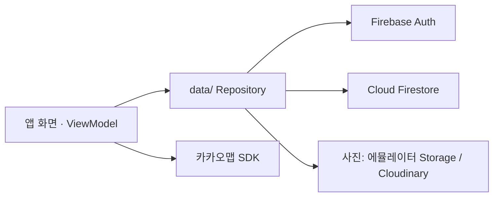

# Walklog

> Record your walk. Pin your photos. Share the way.

GPS로 산책 경로를 기록하고, 찍은 사진을 지도 위 촬영 위치에 핀으로 꽂아 하나의 코스로 공유하는 Android 앱입니다.

**Team 뫱뿌볼** · 안재인 · 인지환 · 황대경

## Tech Stack

- **App**: Kotlin 2.4, Jetpack Compose (Compose BOM 2026.02), Navigation Compose
- **지도**: 카카오맵 SDK 2.15
- **위치**: Fused Location Provider (play-services-location 21.4)
- **사진**: 갤러리에서 고르기 (카메라 촬영 없음)
- **Backend**: Firebase Auth(이메일 · Google 로그인), Cloud Firestore(asia-northeast3) — Firebase BOM 35.2
- **사진 저장**: 평소엔 에뮬레이터 Storage, 시연 땐 Cloudinary(무료, 비서명 업로드)

## 🏗️ 인프라



- 화면은 `data/`의 Repository만 부르고, 어떤 서비스가 붙는지는 `data/AppContainer.kt`가 정합니다.
- **개발**: 각자 노트북의 Firebase Local Emulator Suite(Auth · Firestore · Storage)에 붙습니다.
- **맞춰 보기 · 시연**: 진짜 Firebase(Spark 요금제, 프로젝트 `walklog-e37fa`) + 사진은 Cloudinary.
- 전환은 `android/local.properties`의 `USE_EMULATOR`(true = 에뮬레이터, false = 진짜 Firebase + Cloudinary).
- 자체 서버 · Cloud Functions는 없습니다. 좋아요 수 · 저장 수 같은 값은 앱이 Firestore 트랜잭션으로 함께 바꿉니다.

| `firebase/` 파일 | 역할 |
| --- | --- |
| `.firebaserc` | 기본 Firebase 프로젝트(`walklog-e37fa`) |
| `firebase.json` | 진짜 Firebase에 배포하는 설정(보안 규칙 · 색인) |
| `firebase.emulator.json` | 로컬 에뮬레이터 설정(포트, 개발용 규칙) |
| `firestore.rules` · `storage.rules` | 배포용 보안 규칙 |
| `firestore.dev.rules` · `storage.dev.rules` | 에뮬레이터 전용 규칙(전부 허용) |
| `firestore.indexes.json` | Firestore 복합 색인 |
| `connect-device.sh` | 기기에서 127.0.0.1로 에뮬레이터에 닿게 포트 잇기(adb reverse) |

> - 진짜 Firebase의 Firestore 규칙은 2026-12-14까지 누구나 읽고 쓸 수 있게 열려 있고, 그 뒤로는 로그인한 사람만 읽고 쓸 수 있습니다. 제대로 된 규칙은 아직 할 일입니다.
> - 시연 전에 프로젝트 권한이 있는 사람이 `firebase login` 후 `firebase/`에서 `firebase deploy --only firestore:indexes --project walklog-e37fa`로 색인을 올려야 합니다(에뮬레이터는 색인 없이도 돌아서 놓치기 쉽습니다).

## 폴더 구조

```
WalkLog/
├── android/                 # Android Studio 프로젝트 (이 폴더를 Android Studio로 열기)
│   ├── app/
│   ├── gradle/
│   ├── build.gradle.kts
│   └── settings.gradle.kts
├── firebase/                # 백엔드 설정 · 보안 규칙
├── .github/                 # 이슈 · PR 템플릿, 라벨러
├── .coderabbit.yaml         # CodeRabbit 리뷰 설정
├── AGENTS.md                # AI 작업 규칙
├── CLAUDE.md                # Claude Code용 (AGENTS.md를 불러옴)
├── CONVENTION.md            # 협업 컨벤션
└── README.md
```

### 앱 패키지 구조 (`android/app/src/main/java/.../walklog/`)

`feature/` · `domain/`은 아직 없고, 해당 코드를 만들 때 이 이름으로 추가합니다(PR 라벨러가 경로를 봅니다).

```
walklog/
├── feature/         # (예정)
│   ├── auth/        # 로그인 · 회원가입
│   ├── record/      # GPS 기록, 산책 로그 CRUD
│   ├── photomap/    # 사진 지도, 경로 위 사진 핀
│   ├── discover/    # 코스 검색 · 테마 추천
│   └── mypage/      # 마이페이지 · 프로필
├── data/            # 외부 서비스 접근 (repository)
├── domain/          # (예정) GPS 필터링, 거리 · 구간 계산, 사진 ↔ 경로 매칭, 코스 빌더
└── ui/
    ├── theme/
    ├── components/  # 공통 Compose 컴포넌트
    └── navigation/  # 화면 이동
```

## ▶️ 실행 방법

> 아래 터미널 명령은 macOS 터미널 기준입니다. Windows는:
> - `keytool` 명령(아래 7번)은 **Git Bash**에서 실행합니다(`openssl` · `grep` · `~`가 필요).
> - `./gradlew`와 `firebase/connect-device.sh`는 Windows용 Git이 받을 때 줄바꿈을 CRLF로 바꿔서 Git Bash에서도 실패할 수 있습니다. Gradle은 Android Studio 버튼이나 `.\gradlew.bat …`(PowerShell · Android Studio 터미널), 기기 연결은 아래 `adb reverse` 세 줄을 쓰세요.

### 1. 처음 한 번

1. 설치: Android Studio, Node.js LTS, Java 21 이상(Firebase 에뮬레이터용, 터미널에서 `java -version`이 21 이상이어야 함), Firebase CLI 14 이상(`npm install -g firebase-tools`, 확인은 `firebase --version`)
   - Gradle은 첫 Sync 때 필요한 JDK(25)를 알아서 내려받습니다(인터넷 필요).
   - Windows PowerShell에서 "이 시스템에서 스크립트를 실행할 수 없으므로…(running scripts is disabled)" 오류가 나면 `npm.cmd` · `firebase.cmd`로 부르거나 Git Bash · 명령 프롬프트(cmd)에서 실행하세요. 실행 정책을 바꾸는 방법(`Set-ExecutionPolicy -Scope CurrentUser RemoteSigned`)도 있지만, 보안 설정이라 본인이 판단해서 하세요.
2. 레포 clone

   ```bash
   git clone https://github.com/anjaein/WalkLog.git
   ```

3. Android Studio에서 **`android/` 폴더**를 열고 Gradle Sync가 끝날 때까지 기다리기. 이때 `android/local.properties`가 SDK 경로와 함께 생깁니다(커밋하지 마세요).
4. 팀 드라이브의 `google-services.json`을 `android/app/`에 넣기 (커밋하지 않음)
5. `android/local.properties`에 아래 키 추가. 값은 팀 드라이브의 "local.properties 값.txt"에 있습니다.

   ```properties
   USE_EMULATOR=true
   KAKAO_NATIVE_APP_KEY=...
   CLOUDINARY_CLOUD_NAME=...
   CLOUDINARY_UPLOAD_PRESET=...
   # 선택: 에뮬레이터 주소 (기본 127.0.0.1)
   # EMULATOR_HOST=127.0.0.1
   ```

6. 상단 기기 목록에서 에뮬레이터 또는 테스트 폰을 고르고 ▶️ Run `app`을 한 번 실행하기. 디버그 서명 키(`~/.android/debug.keystore`)가 이때 만들어집니다.
7. 카카오맵 키 해시와 Google 로그인 SHA-1은 노트북마다 다릅니다. 아래 두 값을 뽑아 안재인에게 보내 등록을 부탁하세요.

   ```bash
   # 카카오맵 키 해시
   keytool -exportcert -alias androiddebugkey -keystore ~/.android/debug.keystore -storepass android | openssl sha1 -binary | openssl base64
   # Google 로그인 SHA-1
   keytool -list -v -alias androiddebugkey -keystore ~/.android/debug.keystore -storepass android | grep SHA1
   ```

   `keytool`이 없다고 나오면 Android Studio에 들어 있는 것을 씁니다. 경로에 공백이 있어 따옴표로 감쌉니다: macOS `"/Applications/Android Studio.app/Contents/jbr/Contents/Home/bin/keytool"`, Windows Git Bash `"/c/Program Files/Android/Android Studio/jbr/bin/keytool"`.

### 2. 개발할 때마다

1. 로컬 에뮬레이터 켜기. 레포 루트에서:

   ```bash
   cd firebase
   firebase emulators:start --config firebase.emulator.json --project walklog-e37fa
   ```

2. 위 1번에서 연 터미널은 에뮬레이터가 계속 쓰므로, **새 터미널을 열어 레포 루트에서** 기기(에뮬레이터 · 테스트 폰)를 켜고 연결한 뒤 `./firebase/connect-device.sh` (기기를 켜거나 다시 연결할 때마다)
   - targetSdk 37부터 앱이 10.0.2.2 같은 로컬 네트워크 주소에 붙으려면 별도 권한이 필요해서, adb reverse로 포트를 이어 기기 자신(127.0.0.1)으로 접속합니다.
   - 스크립트는 PATH의 `adb`, 없으면 `$ANDROID_HOME/platform-tools/adb`(기본값은 macOS 경로)를 씁니다. **Windows는 스크립트 대신** PowerShell에서 아래를 실행하세요(SDK를 기본 위치에 설치했다고 가정).

     ```powershell
     $adb = "$env:LOCALAPPDATA\Android\Sdk\platform-tools\adb.exe"
     & $adb reverse tcp:9099 tcp:9099
     & $adb reverse tcp:8080 tcp:8080
     & $adb reverse tcp:9199 tcp:9199
     ```

3. Android Studio에서 ▶️ Run `app`
4. 데이터 보기: http://127.0.0.1:4000 (Emulator UI)

## 📚 문서

| 문서 | 내용 |
| ---- | ---- |
| [Convention](./CONVENTION.md) | 커밋 · 브랜치 · 네이밍 컨벤션과 라벨링 필수 규칙을 정리했습니다. |

## 역할

| 이름 | 담당 |
| --- | --- |
| 인지환 | 로그인 · 사용자 인증, 앱 테스트 |
| 안재인 | 사진 지도 · 경로 핀 표시, 코스 검색 · 추천 |
| 황대경 | 마이페이지 · 프로필 관리, 최종 발표 |
