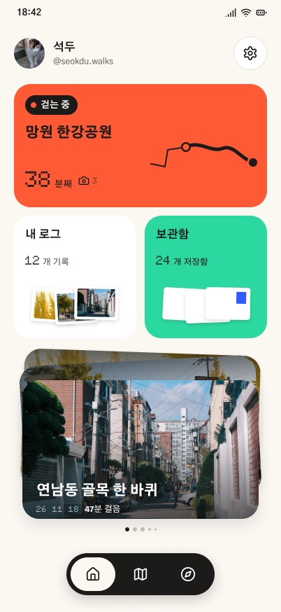
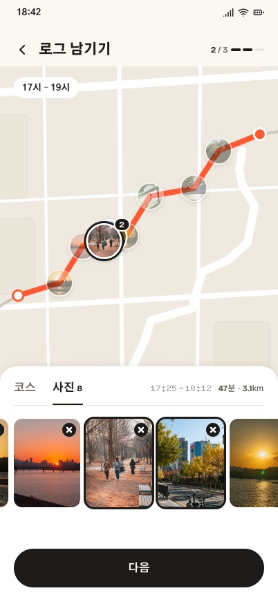
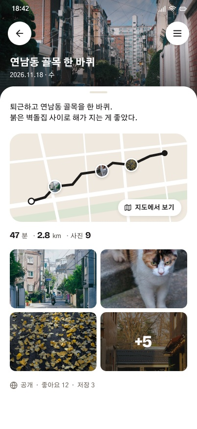
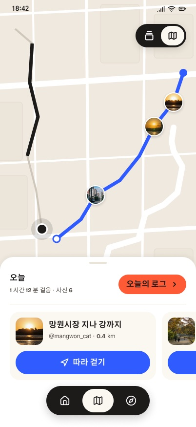
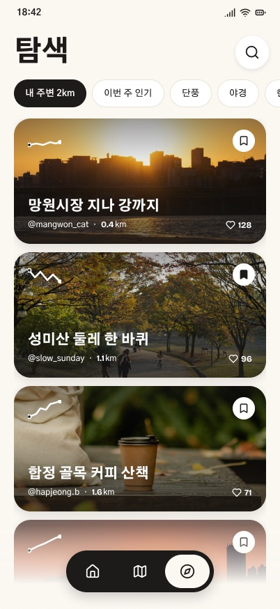
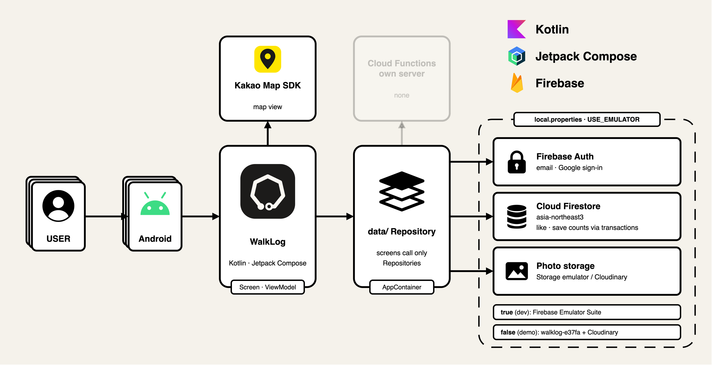

<div align="center">


# Walklog

*Record your walk. Pin your photos. Share the way.*

GPS로 산책 경로를 기록하고, 찍은 사진을 지도 위 촬영 위치에 핀으로 꽂아 하나의 코스로 공유하는 Android 앱입니다.


**Team 뫱뿌볼** · 안재인 · 인지환 · 황대경

</div>

## 📱 화면

<table align="center">
  <tr>
    <td align="center"></td>
    <td align="center"></td>
    <td align="center"></td>
    <td align="center"></td>
    <td align="center"></td>
  </tr>
  <tr>
    <td align="center"><sub>홈</sub></td>
    <td align="center"><sub>로그 남기기</sub></td>
    <td align="center"><sub>로그 상세</sub></td>
    <td align="center"><sub>지도</sub></td>
    <td align="center"><sub>탐색</sub></td>
  </tr>
</table>

<p align="center"><sub>피그마 시안 화면이라 실제 앱과 다를 수 있습니다. (사진: Unsplash)</sub></p>

## ✨ 주요 기능

- **경로 기록**: 걷는 동안 GPS로 산책 경로를 남깁니다.
- **사진 핀**: 갤러리에서 고른 사진을 찍은 위치에 맞춰 경로 위에 핀으로 꽂습니다.
- **코스 공유**: 경로와 사진을 묶어 하나의 코스로 공유합니다.
- **코스 탐색**: 다른 사람의 코스를 검색하고, 테마별 추천을 받아 봅니다.

## 🛠️ Tech Stack

- **App**: Kotlin 2.4, Jetpack Compose (Compose BOM 2026.02), Navigation Compose
- **지도**: 카카오맵 SDK 2.15
- **위치**: Fused Location Provider (play-services-location 21.4)
- **사진**: 갤러리에서 고르기 (카메라 촬영 없음)
- **Backend**: Firebase Auth(이메일 · Google 로그인), Cloud Firestore(asia-northeast3), Firebase BOM 35.2
- **사진 저장**: 평소엔 에뮬레이터 Storage, 시연 땐 Cloudinary(무료, 비서명 업로드)

## 🏗️ 인프라



<sub>그림을 고칠 땐 원본 [`.github/assets/walklog-infra.drawio`](.github/assets/walklog-infra.drawio)를 draw.io에서 열어 고친 뒤, 같은 이름의 PNG로 다시 내보내 주세요.</sub>

- 화면은 `data/`의 Repository만 부르고, 어떤 서비스가 붙는지는 `data/AppContainer.kt`가 정합니다.
- **개발**: 각자 노트북의 Firebase Local Emulator Suite(Auth · Firestore · Storage)에 붙습니다.
- **맞춰 보기 · 시연**: 진짜 Firebase(Spark 요금제, 프로젝트 `walklog-e37fa`) + 사진은 Cloudinary.
- 전환은 `android/local.properties`의 `USE_EMULATOR`(true = 에뮬레이터, false = 진짜 Firebase + Cloudinary).
- 자체 서버 · Cloud Functions는 없습니다. 좋아요 수 · 저장 수 같은 값은 앱이 Firestore 트랜잭션으로 함께 바꿉니다.

| `firebase/` 파일 | 역할 |
| --- | --- |
| `.firebaserc` | 기본 Firebase 프로젝트(`walklog-e37fa`) |
| `firebase.json` | 진짜 Firebase에 배포하는 설정(보안 규칙 · 색인) |
| `firebase.emulator.json` | 로컬 에뮬레이터 설정(포트, 개발용 규칙) |
| `firestore.rules` · `storage.rules` | 배포용 보안 규칙 |
| `firestore.dev.rules` · `storage.dev.rules` | 에뮬레이터 전용 규칙(전부 허용) |
| `firestore.indexes.json` | Firestore 복합 색인 |
| `connect-device.sh` | 기기에서 127.0.0.1로 에뮬레이터에 닿게 포트 잇기(adb reverse) |
| `seed/` · `SEED.md` | 에뮬레이터를 켤 때 불러오는 공용 가짜 데이터와 그 안내 |

> 시연 전 색인 올리기와 보안 규칙 기한(2026-12-14)은 [SETUP.md](./SETUP.md#3-진짜-firebase로-맞춰-보기--시연)에 정리했습니다.

## 📁 폴더 구조

```
WalkLog/
├── android/                 # Android Studio 프로젝트 (이 폴더를 Android Studio로 열기)
│   ├── app/
│   ├── gradle/
│   ├── build.gradle.kts
│   └── settings.gradle.kts
├── firebase/                # 백엔드 설정 · 보안 규칙 · 에뮬레이터 가짜 데이터
├── .github/                 # 이슈 · PR 템플릿, 라벨러, README 그림(assets/)
├── .coderabbit.yaml         # CodeRabbit 리뷰 설정
├── AGENTS.md                # AI 작업 규칙
├── CLAUDE.md                # Claude Code용 (AGENTS.md를 불러옴)
├── CONVENTION.md            # 협업 컨벤션
├── README.md
└── SETUP.md                 # 개발 환경 세팅 안내
```

### 앱 패키지 구조 (`android/app/src/main/java/.../walklog/`)

`feature/` · `domain/`은 아직 없고, 해당 코드를 만들 때 이 이름으로 추가합니다(PR 라벨러가 경로를 봅니다).

```
walklog/
├── feature/         # (예정)
│   ├── auth/        # 로그인 · 회원가입
│   ├── record/      # GPS 기록, 산책 로그 CRUD
│   ├── photomap/    # 사진 지도, 경로 위 사진 핀
│   ├── discover/    # 코스 검색 · 테마 추천
│   └── mypage/      # 마이페이지 · 프로필
├── data/            # 외부 서비스 접근 (repository)
├── domain/          # (예정) GPS 필터링, 거리 · 구간 계산, 사진 ↔ 경로 매칭, 코스 빌더
└── ui/
    ├── theme/
    ├── components/  # 공통 Compose 컴포넌트
    └── navigation/  # 화면 이동
```

## ▶️ 시작하기

처음 세팅은 [SETUP.md](./SETUP.md)를 위에서부터 따라 하세요. Android Studio로는 `android/` 폴더를 엽니다.

## 📚 문서

| 문서 | 내용 |
| ---- | ---- |
| [Setup](./SETUP.md) | 처음 세팅, 개발할 때마다 할 일, 진짜 Firebase로 시연하기, 자주 막히는 문제를 정리했습니다. |
| [가짜 데이터](./firebase/SEED.md) | 에뮬레이터 가짜 데이터 내용, 시험용 계정, 다시 만드는 법을 정리했습니다. |
| [Convention](./CONVENTION.md) | 커밋 · 브랜치 · 네이밍 컨벤션과 라벨링 필수 규칙을 정리했습니다. |

## 👥 역할

| 이름 | 담당 |
| --- | --- |
| 인지환 | 로그인 · 사용자 인증, 앱 테스트 |
| 안재인 | 사진 지도 · 경로 핀 표시, 코스 검색 · 추천 |
| 황대경 | 마이페이지 · 프로필 관리, 최종 발표 |
